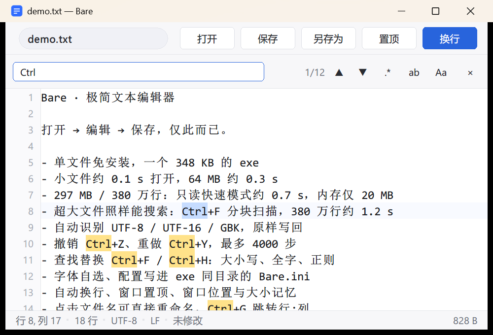
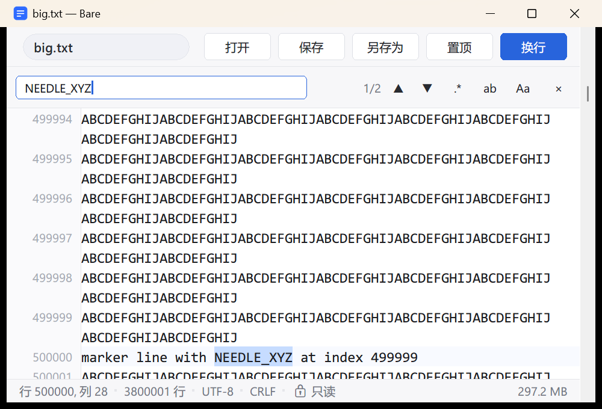

# Bare · 极简文本编辑器

> 打开 → 编辑 → 保存，仅此而已。

一个用**单文件 Win32 / C++17** 写的超轻量 Windows 文本编辑器：整个程序只有一个 exe，双击即用，不需要安装、不依赖运行库。目标是替代记事本——启动快、打字跟手、大文件也不卡，但不把简单的事做复杂。


## 为什么用它

| | |
| --- | --- |
| **一个 exe，约 348 KB** | 静态链接（`/MT`），不依赖 VC++ 运行库，免安装、可放 U 盘 |
| **打开快** | 小文件 ~0.1 s；64 MB / 70 万行 ~0.3 s；297 MB / 380 万行 ~0.7 s |
| **大文件不是摆设** | 超大文件走只读流式模式：内存恒定约 20 MB，照样滚动、跳转、**全文搜索**、复制 |
| **编码不乱改** | 自动识别 UTF-8 / UTF-16 LE/BE / ANSI(GBK) / 字节模式，原样写回；也可手动切换重载 |
| **保存不写坏** | 先写临时文件再 `ReplaceFileW` 原子替换，并保留 `.bak`；每 30 s 落一份恢复快照 |
| **现代外观** | 自绘圆角工具栏、文件名胶囊、分段状态栏，跟随系统深色主题 |
| **克制** | 没有标签页、没有插件市场、没有启动画面；打开就是编辑 |

## 截图

查找与替换（大小写 / 全字 / 正则，命中高亮 + 序号）：



297 MB / 380 万行大文件，只读快速模式下全文搜索「NEEDLE_XYZ」，1.2 s 出结果：



## 下载与使用

1. 从 [Releases](https://github.com/ulyees/Bare/releases) 下载 `Bare.exe`（或直接取仓库里的构建产物）。
2. 双击运行，`Ctrl+O` 打开文件，开始编辑。
3. 想让它代替记事本：右键任意 `.txt` →「打开方式」→「选择其他应用」→ 选中 `Bare.exe` → 勾选「始终使用此应用打开 .txt 文件」。

也支持命令行与拖拽：`Bare.exe D:\notes\a.txt`，或把文件直接拖进窗口。已有未保存内容时会先提示保存。

## 功能

### 编辑
- 撤销 / 重做（`Ctrl+Z` / `Ctrl+Y`），最多 4000 步。
- 查找与替换（`Ctrl+F` / `Ctrl+H`）：区分大小写（`Aa`）、全字匹配（`ab`）、正则（`.*`，支持 `. * + ? [] ^ $ \d \w \s`）；`Enter` / `Shift+Enter` 或 `F3` / `Shift+F3` 上下跳转，当前命中高亮，计数显示 `1/N`。
- 空白字符可视化：空格显示为 ·、Tab 显示为 →（右键菜单开关）；只影响绘制，**复制出去仍是原始空格与 Tab**。
- 字体自选：右键「选择字体…」从系统等宽字体中选择字号，或用 `Ctrl+滚轮` 快速缩放。
- 选中 / 复制 / 剪切 / 粘贴 / 全选（`Ctrl+A/C/X/V`）；Tab 插入 4 空格；Backspace / Delete 正确处理代理对（emoji）。

### 显示
- 自动换行 / 横向滚动两模式（工具栏「换行」）；不换行时底部出现可拖拽横向滚动条，行号始终对应真实行。
- 行号、当前行高亮、选区高亮、查找高亮、行尾符号（可开关）。
- 窗口置顶（按钮，状态记忆）、窗口位置 / 大小 / 字体缩放记忆。
- 打印（`Ctrl+P`），支持选打印机、分页、自动折行。
- 状态栏分段：`行 L, 列 C · N 行 · 编码 · 换行符 · 修改状态`，右侧文件大小；窄窗口自动隐藏次要分段；点击「行/列」直接跳转。

### 文件
- 新建 / 打开 / 保存 / 另存为（`Ctrl+N/O/S`、`Ctrl+Shift+S`）。
- 关闭时如有未保存修改会提示；打开的下一个文件默认新开窗口，不覆盖当前文档。
- 外部程序修改了当前文件会提示：重新载入 / 保持当前内容。
- 点击工具栏里的文件名胶囊就地重命名（悬停出现铅笔图标）。
- `Ctrl+G` 跳转栏，输入 `行` 或 `行:列`（如 `12`、`12:34`）回车跳转。
- 编码与换行符可手动切换：点击状态栏编码 / 换行分段，在 自动检测 / UTF-8 / UTF-16 LE / UTF-16 BE / ANSI / GBK / 字节模式 间切换，或把换行符转换为 CRLF / LF。
- 长路径（>260 字符）支持：清单声明 `longPathAware`，内部统一 `\\?\` 前缀。
- 只读与文件锁感知：文件被独占或只读时自动只读打开，状态栏显示 🔒，编辑操作明确拒绝。
- 保存失败给出具体原因（磁盘满 / 权限不足 / 被占用 / 路径过长）。
- 最近文件：右键「最近打开」保留 10 个，并记住上次目录。
- 配置默认写在 exe 同目录 `Bare.ini`（缺失自动创建）；目录不可写才退回注册表 `HKCU\Software\Bare`。

## 大文件模式

打开超过 256 MB 的文件时会询问是否进入**只读快速模式**：

- 不建立全文件行索引，用 `ReadFile` 分块读取 + 稀疏检查点，只把当前窗口的行解码进内存，内存占用与文件大小基本无关（297 MB → ~20 MB）。
- 仍可：滚动、`Ctrl+G` 跳转、点击状态栏跳转、鼠标选择与复制、以及**全文搜索**。
- 搜索按 4 MB 分块顺序扫描，命中位置缓存，`F3` 跳转几乎瞬时；380 万行 / 297 MB 约 1.2 s 扫完。查找栏在未搜索时显示「Enter 搜索」，避免边打字边扫盘。
- 暂不可用：编辑、替换、保存、打印（状态栏会显示「只读」）。

## 配置文件

默认配置文件是 exe 同目录的 `Bare.ini`，首次运行自动创建（目录不可写则改用注册表）。可以直接在 Bare 里编辑它：

```ini
[Bare]
FontName=Consolas      ; 编辑器字体（系统已安装的等宽字体）
FontPx=16              ; 字号
Wrap=1                 ; 自动换行
ShowEol=1              ; 显示行尾符号
ShowWs=0               ; 显示空白字符（空格 · / Tab →）
TopMost=0              ; 窗口置顶
Max=0                  ; 启动时最大化
ConfigVersion=1
```

## 快捷键

| 快捷键 | 功能 |
| --- | --- |
| `Ctrl+N` | 新建窗口 / 新文档 |
| `Ctrl+O` | 打开 |
| `Ctrl+S` | 保存 |
| `Ctrl+Shift+S` | 另存为 |
| `Ctrl+F` | 查找 |
| `Ctrl+H` | 查找并替换 |
| `Ctrl+G` | 跳转到行:列 |
| `Ctrl+P` | 打印 |
| `F3` / `Shift+F3` | 下一个 / 上一个匹配 |
| `Enter` / `Shift+Enter` | 查找栏内同上 |
| `Ctrl+Z` / `Ctrl+Y` | 撤销 / 重做 |
| `Ctrl+A / C / X / V` | 全选 / 复制 / 剪切 / 粘贴 |
| `Ctrl+Home` / `Ctrl+End` | 文档开头 / 结尾 |
| `Ctrl+滚轮` | 放大 / 缩小字体 |
| `Shift+滚轮` | 横向滚动 |
| `Esc` | 关闭查找 / 跳转栏 |

## 性能

测于本机（Windows 10，MSVC `/O2 /MT` 构建），从启动到主窗口出现：

| 文件 | 大小 | 打开耗时 | 内存占用 |
| --- | --- | --- | --- |
| 中小文本 | 80 B | ~0.1 s | ~22 MB |
| 大文本 | 64.4 MB（70 万行） | ~0.3 s | ~182 MB |
| 超大文本（只读快速模式） | 297 MB（380 万行） | ~0.7 s | ~21 MB |

实现要点：常规文件用 `CreateFileMapping` + `MapViewOfFile` 读入，一次性编码检测与解码，按行切分后只对可见行做 GDI 测量与绘制；超大文件改为 `ReadFile` 分块 + 稀疏检查点，只解码当前窗口。查找按行扫描，命中位置缓存复用。

## 构建

需要 Visual Studio（MSVC）+ Windows SDK：

```bat
build-msvc.bat
```

脚本通过 `vswhere` 找到 `vcvars64.bat`，然后：

```bat
rc /nologo /fo app_res.res app.rc
cl /nologo /O2 /MT /EHsc /std:c++17 /utf-8 Bare.cpp app_res.res ^
   /link /SUBSYSTEM:WINDOWS /OUT:Bare.exe ^
   user32.lib gdi32.lib comdlg32.lib dwmapi.lib shell32.lib advapi32.lib ole32.lib uuid.lib
```

注意：源码必须定义 `NOMINMAX`，否则 `windows.h` 的 min/max 宏会与 `std::max`/`std::min` 冲突；源文件含中文字面量，必须加 `/utf-8`。

## 目录结构

```
Bare.cpp          # 全部源码（单文件，约 4900 行）
Bare.exe          # 构建产物
app.rc / app.ico / app.manifest
build-msvc.bat    # 构建脚本
docs/demo.txt     # 演示文本（上图内容）
docs/screenshot.png / find.png / stream.png
README.md
LICENSE
```

## 设计取舍

- **单文件源码**：整个程序一个 `.cpp`，便于阅读、修改和分发。
- **不做富文本**：纯文本编辑器，不解析语法、不渲染 Markdown。
- **不做多标签**：需要同时看多个文件就开多个窗口。
- **内存换速度**：常规模式按行保存 `std::wstring`，内存约为文件 2–3 倍，换取简单的编辑逻辑与快速绘制；真正的大文件交给只读流式模式。

## 已知限制

- 常规模式单文件上限 2 GB（超过提示跳过）；超过 512 MB 会先询问。
- 常规模式内存约为文件大小 2–3 倍（64 MB 以内建议常规模式）。
- 超过 256 MB 进入只读快速模式：可查找 / 跳转 / 复制，但不能编辑、替换、保存、打印。
- 没有版本历史；保存时生成 `.bak`。
- 仅 Windows（Win7 SP1+，推荐 Win10/11）。

## 许可证

MIT License，见 [LICENSE](LICENSE)。
