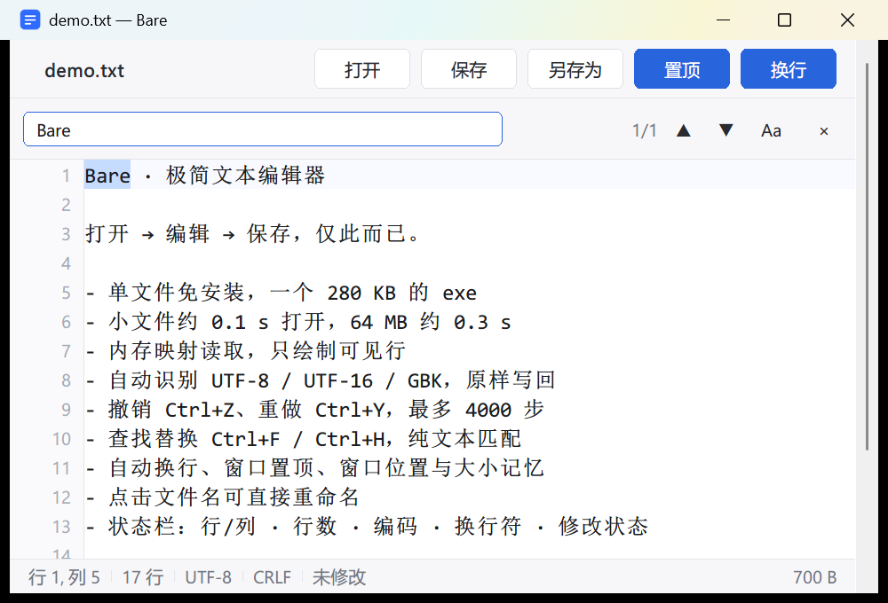

# Bare

极简 Windows 文本编辑器 —— 打开 → 编辑 → 保存，再加上查找替换、撤销重做、编码切换这些真正会用到的功能。没有标签页、没有插件、没有设置面板。

- **单文件免安装**：一个 **280 KB** 的 `Bare.exe`，双击即开，不依赖 .NET / Python / Electron / WebView。
- **打开极快**：小文件约 **0.1 s** 冷启动到可交互；64 MB / 70 万行文本约 **0.3 s**。
- **大文件友好**：内存映射读取（`CreateFileMapping`）+ 只绘制屏幕上可见的那几十行，滚动不卡。
- **不改坏文件**：自动识别 UTF-8 / UTF-8 BOM / UTF-16 LE / UTF-16 BE（含无 BOM）/ ANSI-GBK / 字节模式，按原编码、原换行风格、原末尾换行状态写回；保存走「临时文件 + 原子替换」，并保留 `.bak` 备份。
- **页面现代**：自绘扁平工具栏、淡行号、当前行高亮、跟随系统浅色/深色主题、Segoe UI + Consolas、ClearType、高 DPI、Windows 11 风格深色标题栏。
- **窗口顺手**：位置/大小记忆、置顶、点击文件名直接重命名、关闭前提示保存、外部修改监测。



## 下载 / 使用

直接下载仓库里的 [`Bare.exe`](Bare.exe) 双击即可，绿色免安装，删除即卸载。

| 打开方式 | 操作 |
| --- | --- |
| 空白文档 | 双击 `Bare.exe`，直接输入，Ctrl+S 保存 |
| 打开已有文件 | 点右上角「打开」，或 Ctrl+O，或把文件拖进窗口 |
| 命令行 | `Bare.exe D:\notes\a.txt` |
| 设为默认程序 | 右键 .txt → 打开方式 → 选择其他应用 → 更多应用 → 在这台电脑上查找 → 选中 `Bare.exe` → 勾选「始终使用此应用打开 .txt 文件」 |

## 功能

**编辑**

- 撤销 / 重做，最多保留约 4000 步；连续输入会合并成一步，撤销更符合直觉。
- 查找 / 替换（纯文本匹配，无正则）：`Ctrl+F` 查找、`Ctrl+H` 替换、`F3` / `Shift+F3` 跳转、`Aa` 区分大小写、「从头」切换搜索起点。
- 自动换行开关（工具栏「换行」）：行号始终按逻辑行显示，只是显示上折行；关闭时超长行用横向滚动。
- 点击工具栏左侧文件名即可原地重命名（改的是磁盘上的真实文件名）。
- Ctrl+Backspace / Ctrl+Delete 按词删除。

**文件与编码**

- 状态栏显示：`行 12, 列 34 | 1000 行 | UTF-8 | CRLF | 已修改`，点编码或换行分段可以手动切换。
- 编码菜单：自动检测（重新载入）/ UTF-8 / UTF-16 LE / UTF-16 BE / ANSI / GBK / 字节模式；换行菜单：转换为 CRLF / 转换为 LF / 显示行尾符号。
- 支持超过 260 字符的长路径（自动加 `\\?\` 前缀，manifest 已声明 longPathAware）。
- 外部修改监测：文件被其它程序改动时弹窗询问「重新载入 / 保持当前内容」；保存前若发现磁盘文件已变，会先确认再覆盖。
- 关闭窗口、打开新文件、重新载入前都会提示保存未保存内容。

**窗口**

- 自动记忆位置、大小和最大化状态，以及置顶、自动换行开关（注册表 `HKCU\Software\Bare`）。
- 置顶按钮 / `Ctrl+T`。
- 失焦再回焦时滚动位置和光标保持不动。
- 当前文档已有内容时再从「打开」选文件，会开一个新窗口，不覆盖当前文档。

## 快捷键

| 按键 | 作用 |
| --- | --- |
| Ctrl+N | 新建（当前文档非空时开新窗口） |
| Ctrl+O | 打开文件 |
| Ctrl+S | 保存（未命名文档会弹出另存为） |
| Ctrl+Shift+S | 另存为 |
| Ctrl+F | 打开查找 |
| Ctrl+H | 打开查找 + 替换 |
| Ctrl+Z / Ctrl+Y | 撤销 / 重做（Ctrl+Shift+Z 也可重做） |
| F3 / Shift+F3 | 查找下一个 / 上一个 |
| Enter / Shift+Enter（查找框内） | 下一个 / 上一个 |
| Ctrl+Enter（替换框内） | 全部替换 |
| Tab（替换模式） | 在查找框与替换框之间切换 |
| Esc | 关闭查找框 / 关闭替换行 / 取消选择 |
| Ctrl+T | 窗口置顶 |
| Ctrl+W | 关闭窗口 |
| Ctrl+A / Ctrl+C / Ctrl+X / Ctrl+V | 全选 / 复制 / 剪切 / 粘贴 |
| Ctrl+Home / Ctrl+End | 跳到文档首 / 尾 |
| 方向键、Home、End、PgUp、PgDn | 移动光标（配合 Shift 选择文本） |
| Ctrl+Backspace / Ctrl+Delete | 删除前一个 / 后一个词 |
| 滚轮 / Shift+滚轮 | 垂直滚动 / 横向滚动 |
| Tab | 插入 4 个空格 |

## 查找与替换

按 **Ctrl+F** 打开查找条，输入即时高亮全部匹配并显示 `当前/总数`：

- `▲` / `▼` 或 Enter / Shift+Enter 跳转匹配，F3 / Shift+F3 在窗口内也能用。
- `Aa` 切换区分大小写；`×` 或 Esc 关闭查找条。
- **Ctrl+H** 展开替换行：输入替换文本后 `替换` 换当前匹配、`全部替换` 一次换完；`从头` 让搜索从文档开头开始，而不是从当前光标位置。

## 编码与换行

| 检测 | 处理 |
| --- | --- |
| BOM | UTF-8 / UTF-16 LE / UTF-16 BE 直接识别 |
| 无 BOM UTF-16 | 按零字节分布启发式识别 |
| 合法 UTF-8 | 按 UTF-8 打开 |
| 合法 ANSI | 按系统代码页（简体中文为 GBK）打开 |
| 其它（含 NUL / 非法字节） | 进入**字节模式**，每字节一字符、控制字符显示为 `·`，保存时逐字节还原 |

编码识别错了？点状态栏的编码分段手动切换（会按新编码重新载入）。换行符不一致？点换行分段转换为 CRLF / LF，保存时按当前状态写回。

## 文件保护

- 保存先写同目录临时文件，`FlushFileBuffers` 后用 `ReplaceFileW` 原子替换原文件，写入中断不会留下半个文件。
- 覆盖已有文件时保留一份 `文件名.bak`。
- 文件被其它程序改动：编辑中会提示，保存前会再确认，避免静默覆盖别人的修改。
- 文件被占用 / 无写权限时给出明确错误，不会假装保存成功。

## 为什么快

- 直接 Win32 API + GDI 自绘界面，没有框架初始化、没有 WebView、没有 UI 控件树。
- 文件用内存映射读取，编码识别只扫描 BOM 和少量启发式字节，行切分一次性完成并预留容量。
- 绘制只处理可见行：`ExtTextOutW` 逐行输出，行号、选中、当前行、查找高亮都在同一趟双缓冲里画完，无闪烁。

实测（本机 Windows 10 x64，冷启动到窗口可交互）：

| 文件 | 大小 | 打开耗时 | 内存 |
| --- | --- | --- | --- |
| 小文本 | 0.7 KB | 约 0.1 s | 22 MB |
| 大文本 | 64.4 MB / 70 万行 | 约 0.3 s | 182 MB |

## 自己编译

源码是单个 `Bare.cpp`（Win32 + C++17，无第三方依赖）。

MSVC（推荐，静态 CRT，生成的 exe 免运行库）：

```bat
build-msvc.bat
```

脚本会自动定位 Visual Studio 的 `vcvars64.bat`；也可以手动在 x64 Native Tools Command Prompt 中执行：

```bat
rc /nologo /fo app_res.res app.rc
cl /nologo /O2 /MT /EHsc /std:c++17 /utf-8 Bare.cpp app_res.res /link /SUBSYSTEM:WINDOWS /OUT:Bare.exe user32.lib gdi32.lib comdlg32.lib dwmapi.lib shell32.lib advapi32.lib ole32.lib uuid.lib
```

MinGW-w64（需要 `g++` 与 `windres`）：

```bat
build.bat
```

注意两点：

- 用 MSVC 编译时源码里必须有 `#define NOMINMAX`（已包含），否则 `std::max/std::min` 会被 `windows.h` 的宏破坏。
- 编译前如果 `Bare.exe` 正在运行，会报 `LNK1104`，先退出程序再编译。

## 目录结构

```
Bare.cpp       全部源码（界面、编辑、撤销、查找替换、编码、文件监测）
app.rc         资源脚本（图标 + 清单）
app.ico        图标
app.manifest   DPI / 主题 / 通用控件 6 / 长路径 清单
make_icon.py   重新生成 app.ico（可选）
build-msvc.bat MSVC 构建
build.bat      MinGW-w64 构建
docs/          示例文本与界面截图
```

## 刻意没有的东西

标签页、语法高亮、代码折叠、设置面板、插件、自动保存、文件树、统计面板、多光标。每一项都会带来分支逻辑和体积，这里一个都不留。

## 系统要求与限制

- Windows 7 x64 及以上；沉浸式深色标题栏需要 Win10 1903+（不影响功能）。
- 超大文本内存占用约为文件大小的 2～3 倍；超过 512 MB 会先询问，超过 2 GB 会跳过。
- 二进制文件可以查看，但不适合当二进制编辑器用。
- 编码切换是「按另一种编码重新解释字节」，不会自动转换已有文件的编码；需要转码时请另存为。

## 许可

[MIT](LICENSE) © 2026 ulyees
